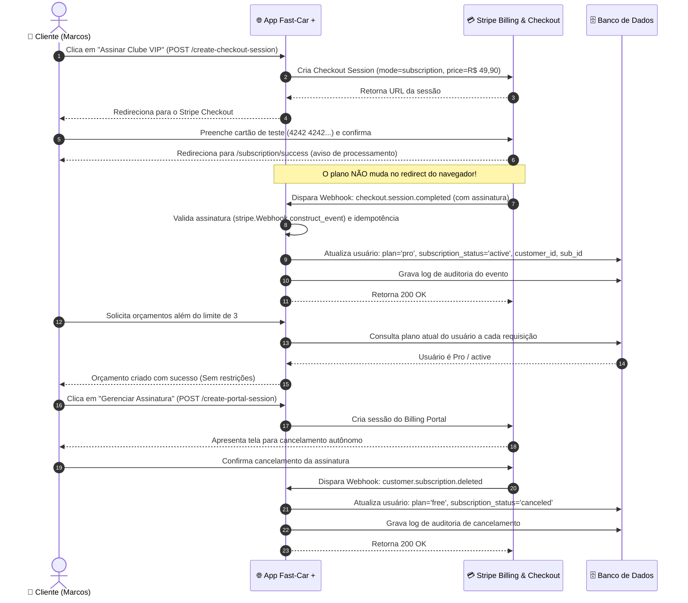

# Documentação Técnica e Arquitetural — Fast-Car + (SaaS Completo)

Este documento detalha a arquitetura, o modelo de assinaturas com Stripe Billing, a validação de webhooks, os limites por plano, as regras de negócio e a especificação técnica do sistema **Fast-Car +**.

> **Professor Responsável:** [github.com/siriani](https://github.com/siriani)  
> **Entrega:** Sexta-feira, 13/11/2026

---

## 1. Especificação Funcional do Sistema SaaS

Do ponto de vista do usuário e do negócio, a plataforma oferece:
- **Landing Page Pública:** Apresentação da proposta de valor, catálogo de serviços, benefícios do clube VIP e atalhos diretos para orçamento e login.
- **Autenticação, Cadastro e RBAC (`/login`, `/register`, `/logout`):** Sistema com separação de papéis (`admin`, `funcionario`, `cliente`) e cadastro de novos clientes que nascem obrigatoriamente no **Plano Free**.
- **Planos e Assinatura Recorrente (`/subscribe`):** Comparativo transparente entre Free (R$ 0,00) e Clube VIP Pro (R$ 49,90/mês), com Checkout Session hospedada no Stripe (`mode="subscription"`).
- **Enforcement de Limites por Plano (Multi-Tenancy):**
  - **Free:** Máximo de 3 orçamentos por conta.
  - **Pro:** Orçamentos ilimitados.
  - O limite é validado no backend tanto na Web (`POST /quotes/new`) quanto na API REST (`POST /api/quotes` com status 403 Forbidden).
- **Portal do Cliente (Stripe Billing Portal):** Botão "Gerenciar Assinatura" que permite ao cliente alterar forma de pagamento, trocar de plano ou cancelar de forma autônoma.
- **Webhooks Seguros e Idempotentes (`POST /webhook`):** Processamento dos 4 eventos essenciais do ciclo de vida da assinatura com validação de assinatura e garantia de não-duplicação de efeitos.
- **Painel Administrativo SaaS (`/admin/saas`):** Painel exclusivo para o administrador com MRR de teste ($$MRR = \text{Assinaturas Ativas} \times R\$\;49,90$$), usuários por plano, assinaturas ativas e histórico auditável dos últimos eventos.

---

## 2. Diagrama de Sequência: Ciclo de Vida da Assinatura

---

## 3. Os Quatro Eventos de Webhook Tratados

| Evento | Condição de Disparo | Ação Executada no Banco de Dados |
| :--- | :--- | :--- |
| `checkout.session.completed` | Checkout de assinatura concluído com sucesso | Associa `stripe_customer_id` e `stripe_subscription_id`, atualiza `plan = 'pro'` e `subscription_status = 'active'`. Registra auditoria. |
| `customer.subscription.updated` | Troca de plano, renovação ou alteração de status | Atualiza `subscription_status`. Se `active`, mantém `pro`. Se `past_due`, marca inadimplente e reverte privilégios Pro. |
| `customer.subscription.deleted` | Cancelamento da assinatura pelo cliente ou oficina | Reverte `plan = 'free'`, marca `subscription_status = 'canceled'` e reativa a cota máxima de 3 orçamentos. |
| `invoice.payment_failed` | Falha na cobrança mensal de renovação | Marca `subscription_status = 'past_due'` e suspende os benefícios Pro (o Pro não continua de graça). |

---

## 4. Estrutura de Níveis de Serviço (Tiers)

| Recurso / Benefício | Plano Free (R$ 0,00) | Clube VIP Pro (R$ 49,90/mês) |
| :--- | :---: | :---: |
| **Limite de Orçamentos** | Máximo de 3 solicitações | **Ilimitado** |
| **Higienização de Ar-Condicionado (Granada)** | Não inclusa (R$ 90 avulsa) | **1 por mês inclusa** |
| **Desconto em Serviços e Peças** | Valor padrão de tabela | **5% de desconto fixo** |
| **Atendimento de Socorro / Resgate** | Fila convencional | **Prioridade máxima VIP** |
| **Customer Portal do Stripe** | Não aplicável | **Disponível para troca/cancelamento** |

---

## 5. Rotas Web e REST API Implementadas

| Rota | Método | Papel Mínimo | Descrição |
| :--- | :---: | :---: | :--- |
| `/` | GET | Público | Landing Page com proposta de valor e CTAs |
| `/services` | GET | Público | Catálogo de serviços com atalhos para orçamento |
| `/register` | GET / POST | Público | Cadastro de novos clientes (nascem no Plano Free) |
| `/login` | GET / POST | Público | Login com credenciais e atalhos rápidos |
| `/quick-login/<id>` | GET | Público | Atalho de teste rápido para Admin, Cliente e Funcionário |
| `/logout` | GET | Autenticado | Encerramento de sessão |
| `/quotes` | GET | Autenticado | Tela de orçamentos (Visão Cliente vs Visão Admin) |
| `/quotes/new` | GET / POST | Cliente / Autenticado | Formulário de criação com validação de limite Free |
| `/quotes/<id>/status` | POST | Admin / Funcionário | Devolução do orçamento: altera status e grava parecer opcional |
| `/quotes/<id>/delete` | POST | Admin | Exclusão de orçamento com confirmação (RBAC) |
| `/subscribe` | GET | Autenticado | Tela de planos e checkout recorrente |
| `/create-checkout-session`| POST | Autenticado | Inicia Checkout de assinatura no Stripe (`mode="subscription"`) |
| `/create-portal-session` | POST | Assinante Pro | Abre o Billing Portal do Stripe para gerenciar/cancelar |
| `/subscription/success` | GET | Autenticado | Retorno informativo pós-checkout |
| `/subscription/cancel` | GET | Autenticado | Retorno de cancelamento do checkout |
| `/webhook` | POST | Público / Stripe | Webhook oficial com validação de assinatura e idempotência |
| `/admin/saas` | GET | Admin | Painel com MRR de teste, usuários por plano e logs |
| `/api/quotes` | GET / POST | Autenticado / API | CRUD com validação estrita de limite Free (403 Forbidden) |
| `/api/quotes/<id>` | GET / DELETE | Autenticado / API | Detalhes e remoção com bloqueio RBAC |
| `/api/saas/metrics` | GET | Admin | API REST com dados consolidados de faturamento e MRR |

---

## 6. Modelo de Dados Relacional (`db/001_dominio.sql`)

### Entidades e Relacionamentos:

1. **`users` (Usuários, Papéis RBAC e Assinaturas Stripe)**
   - `id INT AUTO_INCREMENT PRIMARY KEY`
   - `name VARCHAR(100) NOT NULL`
   - `email VARCHAR(150) NOT NULL UNIQUE`
   - `password_hash VARCHAR(255) NOT NULL`
   - `role ENUM('admin', 'funcionario', 'cliente') NOT NULL DEFAULT 'cliente'`
   - `plan ENUM('free', 'pro') NOT NULL DEFAULT 'free'`
   - `stripe_customer_id VARCHAR(255) NULL`
   - `stripe_subscription_id VARCHAR(255) NULL`
   - `subscription_status ENUM('active', 'past_due', 'canceled', 'unpaid', 'incomplete', 'incomplete_expired', 'trialing') NULL DEFAULT NULL`
   - `created_at TIMESTAMP DEFAULT CURRENT_TIMESTAMP`

2. **`vehicles` (Veículos / Garagem)**
   - `id INT AUTO_INCREMENT PRIMARY KEY`
   - `user_id INT NOT NULL (FK -> users.id)`
   - `model VARCHAR(100) NOT NULL`
   - `year INT NOT NULL`
   - `license_plate VARCHAR(20) NOT NULL UNIQUE`
   - `created_at TIMESTAMP DEFAULT CURRENT_TIMESTAMP`

3. **`quotes` (Orçamentos / Solicitações)**
   - `id INT AUTO_INCREMENT PRIMARY KEY`
   - `user_id INT NOT NULL (FK -> users.id)`
   - `vehicle_id INT NOT NULL (FK -> vehicles.id)`
   - `service_type VARCHAR(100) NOT NULL`
   - `description TEXT NOT NULL`
   - `status ENUM('pendente', 'em_analise', 'aprovado', 'concluido', 'cancelado') NOT NULL DEFAULT 'pendente'`
   - `image_path VARCHAR(255) NULL`
   - `admin_notes TEXT NULL` *(Parecer técnico/valor opcional devolvido pela oficina)*
   - `created_at TIMESTAMP DEFAULT CURRENT_TIMESTAMP`
   - `updated_at TIMESTAMP DEFAULT CURRENT_TIMESTAMP ON UPDATE CURRENT_TIMESTAMP`

4. **`audit_logs` (Histórico de Eventos e Auditoria)**
   - `id INT AUTO_INCREMENT PRIMARY KEY`
   - `event_type VARCHAR(100) NOT NULL`
   - `description TEXT NOT NULL`
   - `user_id INT NULL`
   - `payload TEXT NULL`
   - `created_at TIMESTAMP DEFAULT CURRENT_TIMESTAMP`

5. **`processed_webhooks` (Idempotência de Eventos)**
   - `id VARCHAR(255) PRIMARY KEY`
   - `event_type VARCHAR(100) NOT NULL`
   - `processed_at TIMESTAMP DEFAULT CURRENT_TIMESTAMP`
