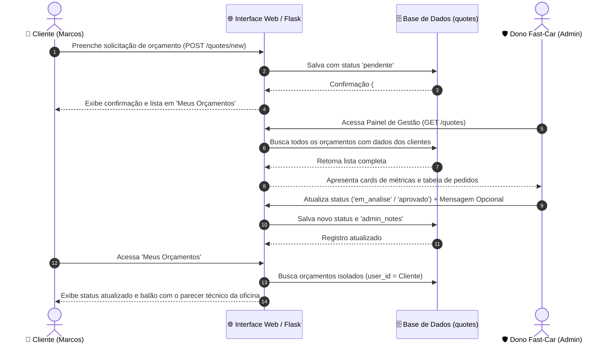

# Documentação Técnica e Arquitetural — Fast-Car +

Este documento detalha a arquitetura, as regras de negócio, o modelo de dados, o controle de acessos (RBAC), o fluxo de orçamentos e a especificação funcional do sistema **Fast-Car +**.

---

## 1. Especificação Funcional do Sistema

Do ponto de vista do usuário e do negócio, a plataforma oferece:
- **Landing Page Pública:** Apresentação da proposta de valor, catálogo de serviços, benefícios do clube VIP e atalhos diretos para orçamento e login.
- **Autenticação e RBAC (`/login` e `/logout`):** Sistema de login com separação de papéis (`admin`, `funcionario`, `cliente`) e atalhos rápidos de demonstração (1-clique).
- **Catálogo de Serviços (`/services`):** Listagem de serviços automotivos com atalhos para solicitar orçamento específico (som, alarmes, iluminação LED, insulfilm e chaves presenciais).
- **Abertura de Orçamentos pelo Cliente (`/quotes/new`):** Envio de solicitações de orçamento com dados do veículo, tipo de serviço, descrição detalhada e fotos.
- **Painel do Cliente (`/quotes`):** Visualização estritamente isolada dos próprios orçamentos (Multi-Tenancy) com status em tempo real, respostas da oficina e botão "+ Pedir Novo Orçamento".
- **Painel Administrativo do Dono (`/quotes`):** Visualização completa de todas as solicitações da oficina, métricas (pendentes, em análise, aprovados), filtros por status e ferramentas de devolução de orçamento com texto opcional ao cliente.
- **Devolutiva com Parecer Técnico Opcional:** O administrador/técnico pode inserir uma mensagem explicativa (ex: valor estimado, prazo, observações de peças) ao mudar o status, que é exibida em destaque no painel do cliente.
- **Clube VIP (Stripe):** Assinatura recorrente para obtenção de descontos e prioridade de atendimento.

---

## 2. Personas e Proposta de Valor

### Personas
- **Marcos (Cliente):** 32 anos, autônomo, proprietário de uma *Toyota Hilux SW4*. Precisa de manutenção rápida, chave inteligente e não pode perder tempo indo à oficina só para pedir preço.
- **Dono Fast-Car (Administrador):** 44 anos, gestor técnico da oficina. Precisa de visão centralizada, gestão de prazos, triagem de serviços e receita recorrente previsível com o Clube VIP.

### Proposta de Valor
A **Fast-Car +** conecta proprietários de veículos à oficina através de um sistema de triagem online sem filas, garagem virtual e Clube VIP por assinatura que garante benefícios mensais e prioridade de resgate.

---

## 3. Planeamento do Modelo SaaS e Níveis de Serviço

### Estrutura de Níveis de Serviço (Tiers)

| Nível / Plano | Mensalidade | Benefícios Inclusos |
| :--- | :---: | :--- |
| **Plano Free** | R$ 0,00 | Orçamentos ilimitados, catálogo de serviços, acompanhamento de status e devolução técnica na plataforma. |
| **Plano Clube VIP** | R$ 49,90/mês | Todos os recursos do Free + **1 Higienização de Ar-Condicionado (Granada) mensal inclusa**, **5% de desconto fixo** em qualquer produto/serviço da oficina e **atendimento prioritário na fila de socorro/oficina**. |

---

## 4. Desenho do Fluxo de Orçamentos

---

## 5. Lean Canvas

| Bloco | Conteúdo |
| :--- | :--- |
| **Problema** | Perda de tempo com orçamentos presenciais, falta de transparência em serviços elétricos/chaves e custos imprevisíveis. |
| **Segmento de Clientes** | Proprietários de veículos que buscam customização, eletrônica embarcada e manutenção estética. |
| **Proposta Única de Valor** | Orçamento inteligente com triagem online sem filas e Clube VIP com higienização mensal e descontos garantidos. |
| **Solução** | 1. Triagem remota com devolutiva técnica. 2. Gestão com RBAC e Multi-Tenancy. 3. Clube VIP por assinatura Stripe. |
| **Canais** | Redes sociais (Instagram), indicação no balcão e QR Code presencial na oficina. |
| **Fontes de Receita** | Execução de serviços automotivos e mensalidades do Clube VIP (R$ 49,90/mês no Stripe). |
| **Estrutura de Custos** | Hospedagem de infraestrutura (Portainer/Docker), insumos de higienização, taxas Stripe e equipe técnica. |
| **Métricas-Chave** | Assinantes VIP ativos, MRR, volume de orçamentos gerados, taxa de conversão em serviços. |
| **Vantagem Injusta** | Loja física já consolidada, ferramental de ponta em OBD2/Smart Key e equipe técnica qualificada. |

---

## 6. Mapa de Reaproveitamento

| Componente do Projeto Base | O que se tornou no SaaS Fast-Car + |
| :--- | :--- |
| **Catálogo de Filmes (TMDB)** | Catálogo de Serviços Automotivos (Chaves Smart Key, Som, Painéis Digitais, LED, Insulfilm) |
| **Microsserviço de Login + RBAC** | Níveis de acesso: `admin` (Dono), `funcionario` (Instalador) e `cliente` |
| **Logs e Auditoria (Redis)** | Eventos de Negócio: criação de orçamento, atualização de status e devoluções técnicas |
| **Upload e Perfil (MinIO)** | Armazenamento de fotos de veículos, chaves presenciais e ordens de serviço |
| **Plano Premium (Stripe)** | Assinatura mensal do Clube VIP Fast-Car + (R$ 49,90/mês) |
| **Deploy e Observabilidade** | Deploy automatizado com Docker Compose no Portainer |

---

## 7. Classificação da Infraestrutura (SaaS, PaaS, IaaS)

| Camada | Componente / Serviço | Justificativa |
| :--- | :--- | :--- |
| **IaaS** | Máquina Virtual (Ubuntu / Proxmox) | Gerenciamos sistema operacional, conectividade, segurança de rede e volumes de persistência. |
| **PaaS** | Containers Docker no Portainer | Plataforma de execução onde rodam a aplicação Flask, banco MariaDB, Redis e MinIO sem gestão manual do SO host. |
| **SaaS** | Stripe API | Serviço pronto de pagamentos e cobrança recorrente consumido diretamente via API externa. |

---

## 8. Arquitetura de Software e Rotas Implementadas

### Rotas Web e REST API

| Rota | Método | Papel Mínimo | Descrição |
| :--- | :---: | :---: | :--- |
| `/` | GET | Público | Landing Page com proposta de valor e CTAs |
| `/services` | GET | Público | Catálogo de serviços com atalhos para orçamento |
| `/login` | GET / POST | Público | Tela de login com credenciais e atalhos rápidos |
| `/quick-login/<id>` | GET | Público | Atalho de teste rápido para Admin, Cliente e Funcionário |
| `/logout` | GET | Autenticado | Encerramento de sessão |
| `/quotes` | GET | Autenticado | Tela de orçamentos (Visão Cliente vs Visão Admin) |
| `/quotes/new` | GET / POST | Cliente / Autenticado | Formulário de criação de novo orçamento |
| `/quotes/<id>/status` | POST | Admin / Funcionário | Devolução do orçamento: altera status e grava parecer opcional |
| `/quotes/<id>/delete` | POST | Admin | Exclusão de orçamento com confirmação (RBAC) |
| `/api/quotes` | GET / POST | Autenticado / API | CRUD REST com isolamento por usuário |
| `/api/quotes/<id>` | GET / DELETE | Autenticado / API | Detalhes e remoção com bloqueio RBAC |

---

## 9. Regras de Negócio e Isolamento de Dados (Lógica "Se X, Então Y")

- **Se** o usuário for um `cliente` comum, **então** ele só pode visualizar e editar os seus próprios orçamentos e dados de perfil (Multi-Tenancy).
- **Se** o usuário for um `admin` ou `funcionario`, **então** o painel de orçamentos exibe todas as solicitações, dados do cliente solicitante e formulário para devolução de orçamento com mensagem técnica.
- **Se** um usuário não autenticado tentar acessar `/quotes` ou `/quotes/new`, **então** é redirecionado para `/login` com aviso em tela.
- **Se** um usuário tentar acessar o ID de um registro pertencente a outro usuário diretamente via URL ou API, **então** o sistema retorna `403 Forbidden` ou `404 Not Found`.
- **Se** uma requisição for feita para uma rota restrita utilizando um papel sem permissão, **então** o sistema bloqueia com `403 Forbidden`.
- **Se** o cliente assinar o plano **Clube VIP**, **então** o status da assinatura é atualizado via webhook do Stripe e os benefícios (descontos e higienização mensal) são liberados no perfil.

---

## 10. Modelo de Dados Relacional (`db/001_dominio.sql`)

### Entidades e Relacionamentos:

1. **`users` (Usuários e Papéis RBAC)**
   - `id INT AUTO_INCREMENT PRIMARY KEY`
   - `name VARCHAR(100) NOT NULL`
   - `email VARCHAR(150) NOT NULL UNIQUE`
   - `password_hash VARCHAR(255) NOT NULL`
   - `role ENUM('admin', 'funcionario', 'cliente') NOT NULL DEFAULT 'cliente'`
   - `created_at TIMESTAMP DEFAULT CURRENT_TIMESTAMP`

2. **`vehicles` (Veículos / Garagem)**
   - `id INT AUTO_INCREMENT PRIMARY KEY`
   - `user_id INT NOT NULL (FK -> users.id)`
   - `model VARCHAR(100) NOT NULL`
   - `year INT NOT NULL`
   - `license_plate VARCHAR(20) NOT NULL UNIQUE`
   - `created_at TIMESTAMP DEFAULT CURRENT_TIMESTAMP`

3. **`quotes` (Orçamentos / Solicitações)**
   - `id INT AUTO_INCREMENT PRIMARY KEY`
   - `user_id INT NOT NULL (FK -> users.id)`
   - `vehicle_id INT NOT NULL (FK -> vehicles.id)`
   - `service_type VARCHAR(100) NOT NULL`
   - `description TEXT NOT NULL`
   - `status ENUM('pendente', 'em_analise', 'aprovado', 'concluido', 'cancelado') NOT NULL DEFAULT 'pendente'`
   - `image_path VARCHAR(255) NULL`
   - `admin_notes TEXT NULL` *(Texto opcional de parecer técnico/valor enviado pelo admin ao devolver o orçamento)*
   - `created_at TIMESTAMP DEFAULT CURRENT_TIMESTAMP`
   - `updated_at TIMESTAMP DEFAULT CURRENT_TIMESTAMP ON UPDATE CURRENT_TIMESTAMP`

