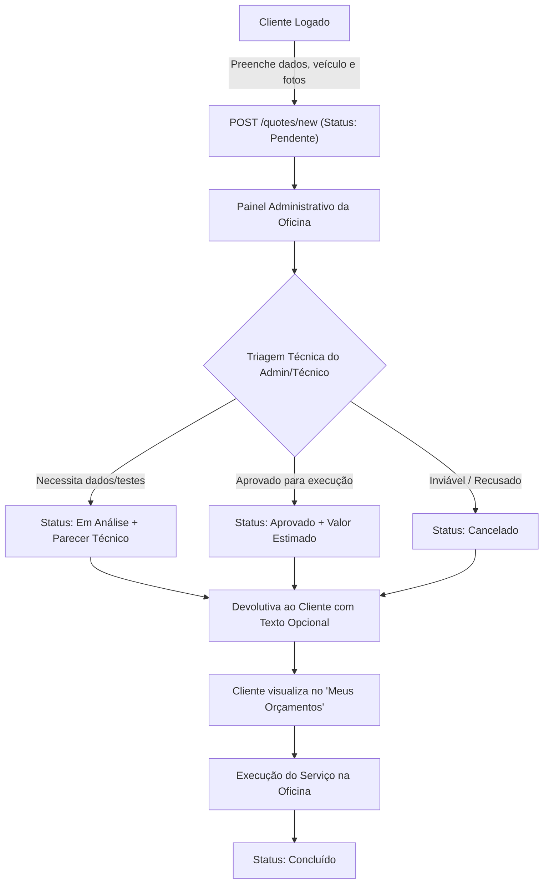

# Fast-Car + | Plataforma de Serviços Automotivos e Clube VIP

Plataforma SaaS para gestão de serviços automotivos de alta performance, orçamentos inteligentes com triagem online, garagem virtual e clube de benefícios por assinatura recorrente.

---

## 1. A Dor do Mercado
Proprietários de veículos que necessitam de estética automotiva, iluminação LED, som, película térmica (insulfilm) e programação de chaves presenciais (*Smart Key*) enfrentam filas desnecessárias e deslocamentos até oficinas apenas para saber se o serviço é viável ou qual o custo estimado. Além disso, a falta de programas de fidelidade gera despesas imprevisíveis e ausência de prioridade em emergências.

---

## 2. Personas

### Persona Primária: Marcos (Cliente)
- **Idade / Perfil:** 32 anos, profissional autônomo, utiliza seu carro (*Toyota Hilux SW4*) diariamente para deslocamentos profissionais e viagens.
- **Necessidades:** Manter a estética e eletroeletrônica do veículo em ordem, obter pré-diagnósticos rápidos sem perder horas de trabalho na oficina e contar com suporte prioritário em caso de perda ou defeito na chave inteligente.
- **Dores:** Perda de tempo com orçamentos presenciais demorados e falta de transparência sobre preços e prazos.

### Persona Secundária: Dono Fast-Car (Administrador)
- **Idade / Perfil:** 44 anos, empresário e gestor técnico de oficina automotiva especializada.
- **Necessidades:** Centralizar todas as demandas de orçamentos em um único painel, delegar serviços para instaladores técnicos, responder com pareceres técnicos/valores estimados e gerar receita recorrente previsível com assinaturas.

---

## 3. Concorrentes e Alternativas
1. **Atendimento via WhatsApp Manual:** Respostas desorganizadas, sem histórico auditável de orçamentos e sem triagem automática das informações do veículo.
2. **Oficinas Tradicionais:** Exigem presença física no balcão até mesmo para diagnósticos simples ou cópias de chave.
3. **Planos de Assistência Genéricos:** Não oferecem serviços estéticos e eletroeletrônicos recorrentes inclusos (como higienização de ar-condicionado mensal).

---

## 4. Proposta de Valor
A **Fast-Car +** conecta proprietários de veículos a uma equipe técnica de ponta por meio de:
- **Orçamentos Inteligentes:** Envio de dados, fotos e sintomas do veículo pela web, com devolução ágil de parecer técnico e orçamento estimado.
- **Isolamento de Dados e Privacidade:** Cada cliente visualiza estritamente os seus próprios veículos e orçamentos (Multi-Tenancy).
- **Clube VIP Recorrente:** Assinatura mensal que garante benefícios fixos, higienização mensal inclusa e prioridade na fila de socorro/oficina.

---

## 5. Planeamento do Modelo SaaS e Níveis de Serviço

### Tabela Comparativa de Níveis de Serviço (Tiers)

| Funcionalidade / Benefício | Nível Free (R$ 0,00/mês) | Nível Clube VIP (R$ 49,90/mês via Stripe) |
| :--- | :---: | :---: |
| **Solicitação de Orçamentos Online** | Ilimitada | Ilimitada |
| **Catálogo de Serviços e Chaves** | Completo | Completo |
| **Acompanhamento de Status e Devolutivas** | Sim | Sim |
| **Higienização de Ar-Condicionado (Granada)** | Não inclusa (R$ 90,00 avulso) | **1 Aplicação por mês inclusa** |
| **Desconto em Peças e Mão de Obra** | Valor integral de tabela | **5% de desconto fixo garantido** |
| **Fila de Atendimento e Resgate Técnico** | Fila padrão | **Prioridade VIP máxima** |
| **Histórico e Garagem Virtual** | Básico | Completo com prioridade de agenda |

### Métricas de Negócio SaaS
- **MRR (Monthly Recurring Revenue):** Faturamento com o Clube VIP via Stripe Billing.
- **Taxa de Conversão de Orçamentos:** Percentual de orçamentos devolvidos que são aprovados e executados.
- **Churn Rate:** Monitoramento da permanência dos assinantes VIP (meta: menos de 3% ao mês).

---

## 6. Fluxo de Orçamentos (Desenho do Processo)

O ciclo de vida de um orçamento na plataforma segue o fluxo desenhado abaixo:



### Etapas Detalhadas do Fluxo:
1. **Abertura pelo Cliente:** O cliente autenticado informa modelo, placa/ano, tipo de serviço e descreve o sintoma, podendo anexar fotos.
2. **Entrada e Triagem:** O orçamento ingressa com status `pendente` e aparece instantaneamente no painel do administrador.
3. **Análise Técnica e Parecer:** O Dono ou Técnico analisa a viabilidade, define o status (`em_analise`, `aprovado`, `concluido`) e insere uma **devolutiva com parecer técnico e valor estimado** (campo opcional).
4. **Recebimento pelo Cliente:** O cliente recebe o feedback destacado em sua tela com o texto claro da oficina.
5. **Finalização:** Uma vez executado na oficina, o status é alterado para `concluido`.

---

## 7. Lean Canvas

| Bloco | Descrição |
| :--- | :--- |
| **Problema** | Perda de tempo com orçamentos presenciais, falta de transparência em serviços elétricos/chaves e custos imprevisíveis. |
| **Segmento de Clientes** | Proprietários de veículos (carros e motos) que buscam customização, eletrônica embarcada e manutenção estética. |
| **Proposta Única de Valor** | Orçamento inteligente com triagem online sem filas e Clube VIP com higienização mensal e descontos garantidos. |
| **Solução** | 1. Triagem remota com resposta técnica. 2. Gestão com RBAC e Multi-Tenancy. 3. Clube VIP recorrente via Stripe. |
| **Canais** | Redes sociais (Instagram), indicação no balcão e QR Code presencial na loja física. |
| **Fontes de Receita** | Execução de serviços automotivos e mensalidades do Clube VIP (R$ 49,90/mês via Stripe). |
| **Estrutura de Custos** | Hospedagem de infraestrutura (Portainer/Docker), insumos de higienização, taxas Stripe e equipe técnica. |
| **Métricas-Chave** | Assinantes VIP ativos, MRR, volume de orçamentos gerados, taxa de conversão em serviços. |
| **Vantagem Injusta** | Loja física já consolidada, ferramental de ponta em OBD2/Smart Key e equipe técnica qualificada. |

---

## 8. Mapa de Reaproveitamento

| Componente do Projeto Base | O que se tornou no SaaS Fast-Car + |
| :--- | :--- |
| **Catálogo de Filmes (TMDB)** | Catálogo de Serviços Automotivos (Chaves Smart Key, Som, Painéis Digitais, LED, Insulfilm) |
| **Microsserviço de Login + RBAC** | Controle de Acesso por Papéis: `admin` (Dono), `funcionario` (Instalador) e `cliente` |
| **Logs e Auditoria (Redis)** | Eventos de Negócio: criação de orçamento, atualização de status e devolutivas ao cliente |
| **Upload e Perfil (MinIO)** | Armazenamento de fotos de inspeção presencial, chaves e painéis de veículos |
| **Plano Premium (Stripe)** | Assinatura mensal do Clube VIP Fast-Car + (R$ 49,90/mês) |
| **Deploy e Observabilidade** | Orquestração via Portainer com Docker Compose e rotas documentadas |

---

## 9. Classificação da Infraestrutura (SaaS, PaaS, IaaS)

| Camada | Componente / Serviço | Justificativa |
| :--- | :--- | :--- |
| **IaaS** | Servidor / Máquina Virtual (Ubuntu / Proxmox) | Gestão direta do sistema operacional base, recursos de hardware, rede, firewall e volumes do Docker. |
| **PaaS** | Containers no Portainer / Docker | Fornece o ambiente de execução gerenciado para a aplicação Flask, banco MariaDB, Redis e MinIO, sem intervenção direta no SO do host. |
| **SaaS** | Stripe Billing API | Software como serviço terceirizado pronto para consumo via API para gestão de cartões, cobranças recorrentes e webhooks. |

---

## 10. Implementação, Banco de Dados e Execução Local

- **Base de Dados (`db/001_dominio.sql`):** Tabelas `users`, `vehicles` e `quotes`, com suporte ao campo `admin_notes` para devolutivas ao cliente, integridade referencial com chaves estrangeiras (`ON DELETE CASCADE`) e seeds iniciais com os 3 perfis.
- **RBAC e Isolamento:** Clientes autenticados só visualizam seus próprios orçamentos (Multi-Tenancy). Administradores têm visão consolidada de todas as solicitações com ferramentas de atualização e exclusão.
- **Devolutiva com Parecer Opcional:** Na tela de gestão, administradores podem atualizar o status e anexar um texto explicativo/orçamento estimado que é exibido diretamente no painel do cliente.

### Como Executar a Aplicação:
```powershell
# Ativar o ambiente virtual e executar
.\.venv\Scripts\python.exe src/app.py
```
Acesse `http://localhost:8204` no navegador.
