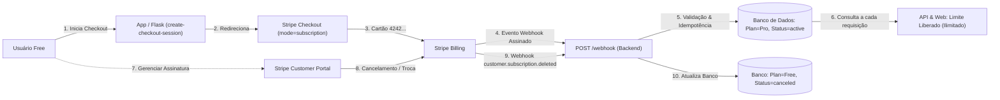

# Fast-Car + | Plataforma SaaS Automotiva e Clube VIP

Plataforma SaaS para gestão de serviços automotivos de alta performance, orçamentos inteligentes com triagem remota, garagem virtual e clube de benefícios por assinatura recorrente integrado ao **Stripe Billing**.

> **Atividade:** SaaS completo — planos, limites e assinatura com Stripe  
> **Professor:** [github.com/siriani](https://github.com/siriani)  
> **Entrega:** Sexta-feira, 13/11/2026

---

## 1. A Dor do Mercado
Proprietários de veículos que necessitam de estética automotiva, iluminação LED, som, película térmica (insulfilm) e programação de chaves presenciais (*Smart Key*) enfrentam filas desnecessárias e deslocamentos até oficinas apenas para saber se o serviço é viável ou qual o custo estimado. Além disso, a falta de programas de fidelidade gera despesas imprevisíveis e ausência de prioridade em emergências.

---

## 2. Personas

### Persona Primária: Marcos (Cliente)
- **Perfil:** 32 anos, profissional autônomo, utiliza seu carro (*Toyota Hilux SW4*) diariamente para deslocamentos profissionais e viagens.
- **Necessidades:** Manter a estética e eletroeletrônica do veículo em ordem, obter pré-diagnósticos rápidos sem perder horas de trabalho na oficina e contar com suporte prioritário em caso de perda ou defeito na chave inteligente.
- **Dores:** Perda de tempo com orçamentos presenciais demorados e falta de transparência sobre preços e prazos.

### Persona Secundária: Dono Fast-Car (Administrador)
- **Perfil:** 44 anos, empresário e gestor técnico de oficina automotiva especializada.
- **Necessidades:** Centralizar todas as demandas de orçamentos em um único painel, delegar serviços para instaladores técnicos, responder com pareceres técnicos/valores estimados e gerar **receita recorrente previsível (MRR)** com o Clube VIP por assinatura.

---

## 3. Proposta de Valor
A **Fast-Car +** conecta proprietários de veículos à oficina através de:
- **Orçamentos Inteligentes:** Envio de dados, fotos e sintomas do veículo pela web, com devolução ágil de parecer técnico e valor estimado.
- **Controle de Limites por Plano (Multi-Tenancy):** Usuários do plano Free contam com até 3 orçamentos gratuitos. Usuários assinantes do Clube VIP (Pro) têm solicitações ilimitadas.
- **Clube VIP Recorrente via Stripe:** Assinatura mensal que garante benefícios fixos, 1 higienização de ar-condicionado mensal inclusa, 5% de desconto e atendimento prioritário de socorro.

---

## 4. O Ciclo de Vida da Assinatura (Arquitetura SaaS)

> **Regra Fundamental:** *Assinatura é um estado, não um pagamento único.* O plano do usuário nunca muda porque o navegador voltou do checkout dizendo "deu certo". Ele muda exclusivamente quando o **Webhook do Stripe** chega ao servidor, é validado criptograficamente e processado no banco de dados.



---

## 5. Webhooks do Stripe e Atualização do Banco de Dados

A rota `POST /webhook` valida a assinatura criptográfica (`stripe.Webhook.construct_event`) e trata a **idempotência** (garantindo que o reenvio de um mesmo evento pelo Stripe não duplique efeitos).

| Evento do Stripe | Quando Chega | O que o App Fast-Car + Faz no Banco |
| :--- | :--- | :--- |
| `checkout.session.completed` | O cliente concluiu o checkout da assinatura com sucesso | Grava o `stripe_customer_id`, `stripe_subscription_id`, altera o plano para `pro` e status para `active`. Registra log de auditoria. |
| `customer.subscription.updated` | Troca de plano, renovação ou mudança de status | Atualiza o `subscription_status`. Se `active`, mantém `pro`. Se `past_due`, marca inadimplente e suspende benefícios Pro. |
| `customer.subscription.deleted` | A assinatura terminou ou foi cancelada no portal | Reverte o usuário para o plano `free`, marca status como `canceled` e reativa a trava de 3 orçamentos. |
| `invoice.payment_failed` | A cobrança da renovação falhou | Marca a assinatura como inadimplente (`past_due`) e suspende o Pro (o Pro não continua de graça). |

---

## 6. Portal do Cliente (Stripe Customer Portal)
O cliente conta com o botão **"Gerenciar Assinatura"** que abre o Billing Portal hospedado pelo Stripe (`stripe.billing_portal.Session.create`).
Nele, o cliente pode:
- Trocar de plano;
- Atualizar a forma de pagamento (cartão);
- Cancelar a assinatura de forma autônoma.
Ao cancelar, o Stripe dispara o evento `customer.subscription.deleted`, que reverte a conta para Free de forma 100% automatizada.

---

## 7. Limites por Plano no Backend (API e Web)
O limite é validado no backend a cada requisição (não depende de travas apenas no front-end):
- **Plano Free:** Máximo de **3 orçamentos** por conta.
- **Plano Clube VIP (Pro):** **Orçamentos ilimitados**.
- **Bloqueio na API (`POST /api/quotes`):** Ao atingir 3 orçamentos, recusa com status `403 Forbidden`:
  ```json
  {
    "error": "Limite do plano Free atingido",
    "message": "Você atingiu o limite de 3 orçamentos do plano Free. Faça upgrade para o Clube VIP (Pro) para ter solicitações ilimitadas!",
    "limit": 3,
    "current_count": 3,
    "plan": "free",
    "upgrade_url": "/subscribe"
  }
  ```
- **Bloqueio na Web (`POST /quotes/new`):** Bloqueia o envio, emite flash message explicativa e redireciona para a página `/subscribe`.

---

## 8. Painel Administrativo com MRR e Métricas SaaS
Disponível exclusivamente para o perfil `admin` em `/admin/saas` e no painel `/quotes`:
- **Usuários por Plano:** Contagem em tempo real de clientes no plano Free vs. plano Pro.
- **Assinaturas Ativas:** Total de clientes pagantes ativos no Stripe.
- **MRR de Teste (Monthly Recurring Revenue):** Soma da receita mensal das assinaturas ativas ($$MRR = \text{Assinaturas Ativas} \times R\$\;49,90$$).
- **Últimos Eventos de Auditoria:** Tabela com o histórico auditável de webhooks recebidos, ativações, cancelamentos e tentativas bloqueadas.

---

## 9. Lean Canvas

| Bloco | Descrição |
| :--- | :--- |
| **Problema** | Perda de tempo com orçamentos presenciais, falta de transparência em serviços elétricos/chaves e custos imprevisíveis. |
| **Segmento de Clientes** | Proprietários de veículos (carros e motos) que buscam customização, eletrônica embarcada e manutenção estética. |
| **Proposta Única de Valor** | Orçamento inteligente com triagem online sem filas e Clube VIP com higienização mensal e descontos garantidos. |
| **Solução** | 1. Triagem remota com devolutiva técnica. 2. Gestão com RBAC e Multi-Tenancy. 3. Clube VIP recorrente via Stripe Billing. |
| **Canais** | Redes sociais (Instagram), indicação no balcão e QR Code presencial na oficina. |
| **Fontes de Receita** | Execução de serviços automotivos e mensalidades do Clube VIP (R$ 49,90/mês no Stripe). |
| **Estrutura de Custos** | Hospedagem de infraestrutura (Portainer/Docker), insumos de higienização, taxas Stripe e equipe técnica. |
| **Métricas-Chave** | Assinantes VIP ativos, MRR, volume de orçamentos gerados, taxa de conversão em serviços. |
| **Vantagem Injusta** | Loja física já consolidada, ferramental de ponta em OBD2/Smart Key e equipe técnica qualificada. |

---

## 10. Mapa de Reaproveitamento

| Componente do Projeto Base | O que se tornou no SaaS Fast-Car + |
| :--- | :--- |
| **Catálogo de Filmes (TMDB)** | Catálogo de Serviços Automotivos (Chaves Smart Key, Som, Painéis Digitais, LED, Insulfilm) |
| **Microsserviço de Login + RBAC** | Controle de Acesso por Papéis: `admin` (Dono), `funcionario` (Instalador) e `cliente` |
| **Logs e Auditoria (Redis)** | Eventos de Negócio e Webhooks do Stripe: `checkout.session.completed`, `customer.subscription.deleted`, etc. |
| **Upload e Perfil (MinIO)** | Armazenamento de fotos de inspeção presencial, chaves e painéis de veículos |
| **Plano Premium (Stripe)** | Assinatura Recorrente Mensal do Clube VIP (R$ 49,90/mês via Stripe Subscriptions) |
| **Deploy e Observabilidade** | Deploy automatizado no Portainer com Docker Compose e variáveis de ambiente seguras |

---

## 11. Classificação da Infraestrutura (SaaS, PaaS, IaaS)

| Camada | Componente / Serviço | Justificativa |
| :--- | :--- | :--- |
| **IaaS** | Máquina Virtual (Ubuntu / Proxmox) | Gestão direta do sistema operacional base, recursos de hardware, rede, firewall e volumes do Docker. |
| **PaaS** | Containers no Portainer / Docker | Fornece o ambiente de execução gerenciado para a aplicação Flask, banco MariaDB, Redis e MinIO sem gestão manual do SO host. |
| **SaaS** | Stripe Billing & Customer Portal API | Software como serviço terceirizado pronto para consumo via API para gestão de cartões, cobranças recorrentes, faturamento e portal do cliente. |

---

## 12. Segurança: Chaves e Variáveis de Ambiente
Nenhuma chave secreta é comitada no repositório. O arquivo `.env.example` lista as variáveis necessárias:
```env
SECRET_KEY=fastcar_secret_key_2026
PORT=8204
DOMAIN_URL=http://localhost:8204
STRIPE_SECRET_KEY=sk_test_...
STRIPE_PUBLISHABLE_KEY=pk_test_...
STRIPE_WEBHOOK_SECRET=whsec_...
STRIPE_PRO_PRICE_ID=price_...
```
No Portainer, as chaves reais são informadas na seção de **Environment variables** da Stack.

---

## 13. Passo a Passo do Cenário de Testes

1. **Criar Nova Conta (`/register`):**
   - Acesse `/register` e crie uma nova conta (ex: `teste@email.com`).
   - A conta nasce automaticamente no **Plano Free**.
2. **Estourar o Limite do Free:**
   - Crie 3 orçamentos pelo formulário (`/quotes/new`).
   - Tente criar o 4º orçamento: a aplicação e a API barram com mensagem clara de limite atingido.
3. **Assinar o Clube VIP (Pro):**
   - Acesse `/subscribe` e clique em *Assinar Clube VIP Pro*.
   - Use o cartão de teste do Stripe: `4242 4242 4242 4242`, qualquer validade futura e qualquer CVC.
   - Retorne ao app: quando o webhook `checkout.session.completed` for recebido, a conta vira **Pro** e o limite desaparece.
4. **Criar Novos Orçamentos:**
   - Como Pro, crie novos orçamentos sem nenhuma trava de limite.
5. **Cancelar pelo Portal do Cliente:**
   - Clique em *Gerenciar Assinatura*, abrindo o Stripe Customer Portal.
   - Cancele a assinatura. O webhook `customer.subscription.deleted` reverte o plano para **Free**.
6. **Painel Admin:**
   - Faça login como Admin (`admin@fastcar.com`) e visualize em `/admin/saas` os usuários por plano, assinaturas ativas, o MRR de teste e os últimos eventos do log.
